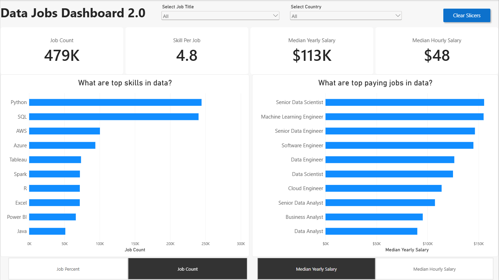

# Data Jobs Dashboard v2 w/ Power BI

## Introduction

This Dashboard was created for **Job Seekers, Job Transitioners, and Job Swappers** to solve a common problem: information about the data job market is scattered and hard to grasp. Using a *real-world dataset of 2024 data science job postings* (including titles, salaries, and locations), this project offers a streamlined, single-page interface to quickly explore crucial market trends and compensation insights.

## Skills Showcased

- 🎨 **Dashboard Design:** Crafting an intuitive and visually appealing report layout
- ⚙️ **Power Query ETL:** Performing data cleaning, shaping, and transformation.
- 🔗 **Data Modeling:** Building efficient data models with relationships (Star Schema principles)
- 🧮 **DAX Fundamentals:** Creating calculations and aggregations to derive key insights.
- 📊 **Visualizations Utilized**: 
  - **Core Charts:** Bar charts.
  - **Cards:** To hightlight key metrics.
  - **Buttons:** To create a seamless navigation experience.
  - **Slicers:** Enabling Dynamic, user-driven data filtering.

## Dashboard Overview

This second iteration consolidates the dashboard into a **single, focused page**, designed to give job seekers the most critical market insights at their fingertips.

This page acts as your main entry point, providing a quick overview of the job market trends, and enabling users to explore more detailed insights through various interactive elements. It showcases key performance indicators like **Job Count, Skills per Job, Median Yearly Salary, and Median Hourly Salary**. You can also quickly see **Skill Popularity** (by job percent or count) and compare **Salaries across different Job Titles**, all designed for an efficient overview.

## Conclusions

This updated dashboard (Version 2.0) showcases Power BI's ability to transform extensive job posting data into a powerful, streamlined tool for career analysis. It empowers **Job Seekers, Job Transitioners, and Job Swappers** by allowing them to filter and explore essential market insights efficiently on a single page, helping them make informed decisions about their next career move.