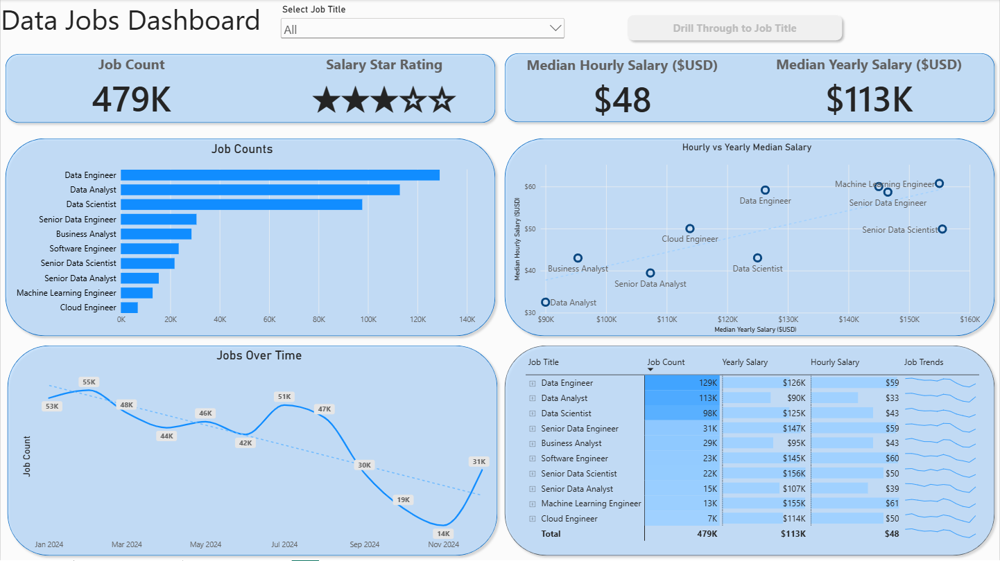
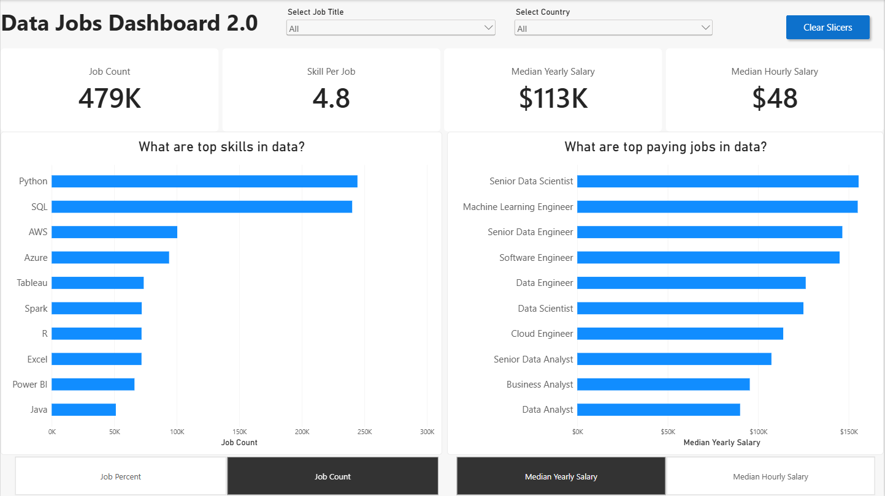

# My Power BI Dashboard Portfolio 📊

This repository is a collection of Power BI dashboards I have developed. It tracks my journey in using Power BI, from foundational reports to more advanced interactive analyses, all aimed at turning data into clear, actionable insights.

# Featured Dashboards

Explore the dashboards below. Each has its own dedicated README with more details on the build process and specific features.

## 📉 Data Jobs Dashboard (V1 - Comprehensive Exploration)

**Key Power BI Skills Utilized:**
- 🎨 Dashboard Layout & Design
- 📊 Core Charts (Bar, Line, Area, Column)
- 🗺️ Map Visualizations for Geospatial Data
- 🔢 KPI Cards & Detailed Data Tables
- 🔘 Buttons for Page Navigation
- ➡️ Drill-Through Functionality

[➡️ **View Full Project 1 Details (README)**](/Data_Jobs_v1/README.md)

---
## 📊 Data Jobs Dashboard 2.0 (V2 - Single-Page Focus)

Version 2.0 of the Data Jobs Dashboard streamlines the analysis into a highly focused, single-page experience. It's optimized to deliver the most critical insights quickly to job seekers, featuring dynamic interactions and more advanced analytical capabilities.

**Key Power BI Skills Utilized (demonstrating progression):**
* 🎨 Advanced Dashboard Design (Single-Page UX & Optimization)
* ⚙️ Complex Power Query Transformations
* 🔗 Star Schema Data Modeling Principles
* 🧮 Explicit DAX Measures (e.g., `CALCULATE`, context modifiers)
* 📊 Dynamic Visualizations (driven by Parameters/Slicers)
* ⚙️ Field & Numeric Parameter Implementation for "What-If" Analysis
* 🔢 Advanced Card Visualizations
* 🎚️ Optimized Slicers & Advanced Cross-Filtering Techniques
* ✨ Report Performance Considerations

[➡️ **View Full Project 2 Details (README)**](/Data_Jobs_v2/README.md)

## About This Portfolio

Each dashboard linked above has its own detailed `README.md` file within its respective project folder. These offer deeper insights into the project objectives, data sources, specific Power BI techniques employed, and a closer look at the dashboard build.